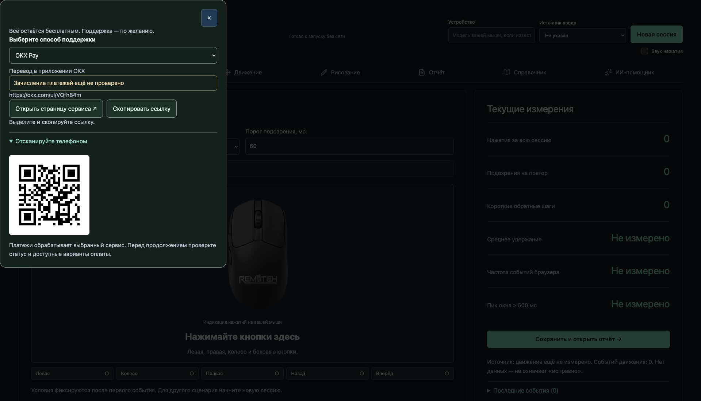

# RemTeh Mouse Tester 1.3.1 preview

Проверка наблюдаемых событий мыши в браузере: кнопки, удержание, колесо, движение и рисование. Текущая сессия не сбрасывается при смене вкладок. История, JSON, импорт для сравнения и печать / PDF работают без ИИ.

[**Открыть Mouse Tester онлайн →**](https://remteh-by.github.io/Mouse-Tester/) · [Production ZIP, исходники и SHA-256](https://github.com/remteh-by/Mouse-Tester/releases/tag/v1.3.1).

| Быстрые проверки онлайн | | | | |
|---|---|---|---|---|
| [**Кнопки и удержание**](https://remteh-by.github.io/Mouse-Tester/#buttons) | [**Колесо**](https://remteh-by.github.io/Mouse-Tester/#wheel) | [**Движение**](https://remteh-by.github.io/Mouse-Tester/#movement) | [**Рисование**](https://remteh-by.github.io/Mouse-Tester/#sensor) | [**Отчёт**](https://remteh-by.github.io/Mouse-Tester/#report) |


## Новое в 1.3.1

Боковые клавиши больше не нарисованы отдельными накладками: двигаются исходные тонкие кнопки на левой грани мыши. Смещение и тень показывают нажатие без растягивания пластика. Стрелки и гравировка официального логотипа сохранены.

Онлайн-версия устанавливается как PWA. После сообщения «Готово к запуску без сети» страницу можно открыть без интернета, включая новый запуск браузера. Новая версия предлагает сохранить сессию и обновиться; работающая проверка сама не перезагружается. После восстановления очищаются физически зажатые кнопки и временное окно частоты, а накопленные счётчики сохраняются.

## Новое в 1.2.2

При нажатии всех пяти кнопок появляются белые стрелки. Боковые кнопки вписаны в левую грань корпуса, подписаны «Вперёд» и «Назад» и заметно уходят внутрь корпуса. Логотип оформлен как гравировка с мягким металлическим переливом; при уменьшении движения в настройках системы перелив отключается. Форма официального логотипа и исходное изображение мыши сохранены. Среднее нажатие смещает только резиновое колёсико: пластиковая рамка остаётся жёсткой. Прямые ссылки открывают нужную проверку, смена вкладок сохраняет текущую сессию.

## Новое в 1.2.1

Кнопки на изображении визуально вдавливаются за счёт смещения, перспективы и тени — без зелёной заливки. При прокрутке появляется белая стрелка над или под колёсиком. На корпусе размещён исходный официальный белый логотип RemTeh. Основное изображение мыши не менялось.

## Новое в 1.2.0

Новый адаптивный интерфейс, оригинальная реалистичная мышь без фона и индикация пяти кнопок/колеса прямо на изображении. Одновременное нажатие левой и правой кнопки учитывается раздельно. Состояние зажатых кнопок очищается при потере фокуса. Условия и ограничения измерений видны рядом с результатами.

[Выбрать способ поддержки RemTeh](SUPPORT.md): добровольно, без блокировки тестов. После сохранения отчёта доступно ненавязчивое приглашение с возможностью скрыть его на 30 дней. Платёж проходит на стороне выбранного сервиса; приложение не получает карточные данные и не заявляет автоматическую проверку оплаты.

## Онлайн-версия

Откройте [remteh-by.github.io/Mouse-Tester](https://remteh-by.github.io/Mouse-Tester/). Установка не нужна. Используется то же исходное изображение оригинальной мыши без фона, что на странице [теста мышки RemTeh](https://remteh.by/remont-myshek/test-myshek).

Кнопки, колесо, движение, рисование, локальная история, сравнение JSON и печать работают в браузере. Измерения автоматически никуда не отправляются. ИИ-помощник в этой онлайн-версии не подключён. Основные тесты доступны без оплаты.

## Запуск

Требуется Node.js 22.12+ и npm. Из корня проекта:

```sh
npm ci
cp .env.example .env.local
npm run dev
```

Откройте http://localhost:3000. Для production:

```sh
npm run build
npm start
```

Production запускает Express с NODE_ENV=production, раздаёт только dist/client. Backend и sourcemap находятся отдельно в dist/server. По умолчанию сервер слушает 127.0.0.1. Для сети нужны явно заданный HTTPS PUBLIC_ORIGIN, соответствующий reverse proxy и проверка его ограничений. Онлайн-версия на GitHub Pages публикует интерфейс без сервера ИИ; локальный запуск Express по этой инструкции остаётся доступен.

## Смысл измерений

Браузерная частота событий — не USB polling rate, DPI, аппаратная задержка или лабораторная точность. Используется pointerrawupdate, если доступен, иначе pointermove; coalesced samples дедуплицируются. Нет данных обозначается null / «Не измерено». Паузы и потеря фокуса не добавляются в частоту. Мышь/трекпад указываются пользователем, а не угадываются по имени браузера.

В свободном тесте быстрый двойной клик не объявляется дефектом. Управляемый тест одиночных нажатий отмечает только подозрение по интервалу release → press. Для колеса короткие противоположные шаги учитываются только в выбранном направлении, на мыши и внутри временного окна. Инерция трекпада и паузы не доказывают неисправность.

Суммарные счётчики не зависят от ограничения журнала: экспорт содержит последние 512 исходных наблюдений и признак усечения. Изменение условий требует новой сессии. Рисование отображает последние 4096 точек в относительных координатах, не физические миллиметры.

## Сессии и приватность

Рабочая сессия автоматически сохраняется отдельно для каждой вкладки. Закрытая сессия может быть восстановлена при следующем открытии; для надёжного хранения результата используйте «Сохранить сессию» и экспорт JSON. Последние 20 отчётов хранятся в localStorage этого браузера; JSON можно экспортировать отдельно. Повреждённый/чужой формат до 512 КБ отклоняется без замены текущих данных. Импорт предназначен для сравнения. Печатная версия показывает условия, выборку и ограничения, не выдаёт печать «исправен».

Статическая онлайн-версия кэширует только файлы приложения после успешной подготовки автономной копии. Сессии и отчёты хранятся отдельно в браузере; удаление данных сайта удаляет и их, и автономную копию. В локальной серверной сборке PWA не включена. ИИ требует сети и отдельно настроенного сервера. Серийные номера и клиентские данные не собираются автоматически. Не вводите секреты в название и комментарий. CRM не подключена.

## Необязательный ИИ

ИИ по умолчанию выключен. Существующий провайдер — Google Gemini. Для включения оператор отдельно задаёт AI_ENABLED, GEMINI_API_KEY, доступный GEMINI_MODEL и независимый AI_ACCESS_TOKEN минимум 32 символа в .env.local. Не вводите провайдерский API-ключ в браузер. Код оператора хранится только в памяти открытой страницы.

Перед каждой отправкой пользователь видит состав данных и подтверждает передачу: название устройства, вопрос и текущие показатели. Комментарий, история сессий, файлы и сырые события не передаются. Ответ отображается текстом, без исполнения HTML. Модель/платёжный аккаунт не переключаются автоматически.

Ограничения: JSON до 16 КБ, контекст до 8000 символов, история до 6 коротких сообщений, 5 запросов/минуту на операторский доступ, один активный запрос, 20 запросов/день по умолчанию (максимум 100), до 1024 выходных токенов, таймаут 20 секунд. Резерв квоты сохраняется в приватном DATA_DIR до обращения к провайдеру и не возвращается после отмены. Это один процесс/оператор, не многопользовательский сервис. Не запускайте несколько инстансов с общей или раздельной квотой: для горизонтального развёртывания нужен транзакционный общий лимитер. Это ограничение количества запросов/токенов, не обещание точной стоимости; установите бюджет также у провайдера.

[Актуальные модели Gemini](https://ai.google.dev/gemini-api/docs/models) · [SDK cancellation and request options](https://googleapis.github.io/js-genai/release_docs/interfaces/types.GenerateContentConfig.html). Проверки используют только поддельный транспорт; оплачиваемые запросы не выполнялись.

## Проверки и статус

```sh
npm run lint
npm test
npm run build
npm run build:site
npm run test:site
npm run test:offline
```

Тесты покрывают ложную частоту по умолчанию, дедупликацию, паузы, ограниченный журнал, обычный двойной клик, управляемую прокрутку, импорт, отказ без авторизации, ограничения, квоту после перезапуска, таймаут и параллельные запросы. Браузерная проверка Chrome/macOS охватывает 360/390/414/1440/1920/2560/3840 px, сохранение и экспорт. Это не физическая проверка аппаратной частоты разных мышей.

Лицензия проекта не была определена владельцем; добавление новой лицензии не выполнено. Лицензии сторонних зависимостей сохраняются. Версия распространяется как предварительный выпуск без физической аппаратной приёмки.

Browser regression: run `npx playwright install chromium`, then `npm run test:browser` after the production build. The test launches an isolated loopback server with AI disabled, checks 360–3840px, export/history/offline behavior and failed-storage preservation.


## Публикация сайта

Сборка: `npm run build:site`. Проверка именно статического сайта в подпапке: `npm run test:site`. Workflow Pages публикует только `dist/site` после проверки. Проверка `test:offline` закрывает браузер, запускает его заново без сети, сохраняет отчёты из двух вкладок и проверяет обновление при отказе хранилища. Секреты, серверный код и локальные данные в эту папку не входят.

## Support options

[Ko-fi, Afdian, Boosty, DonationAlerts, DonatePay and OKX Pay](SUPPORT.md). Optional support; each method shows its current setup/payment-verification status.


